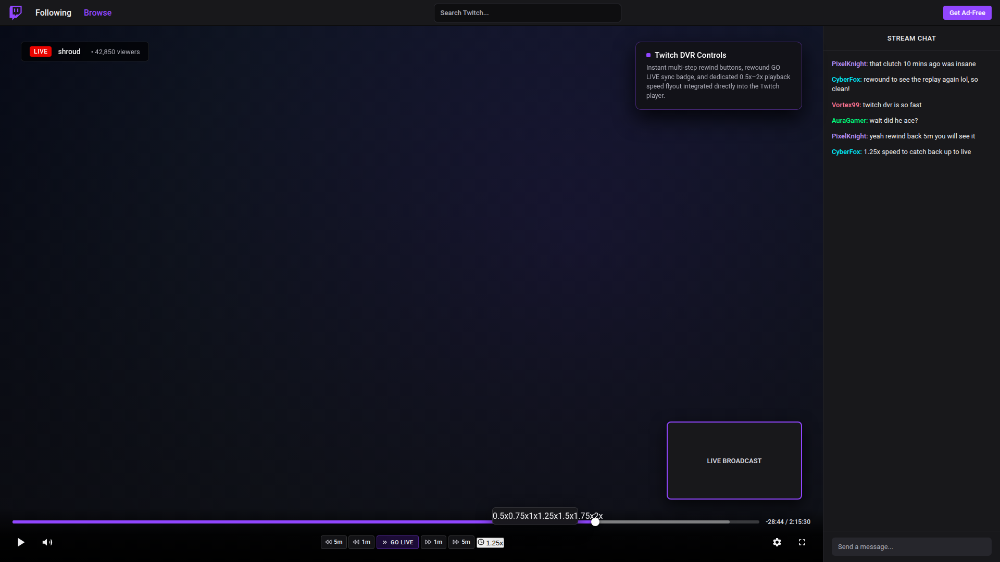
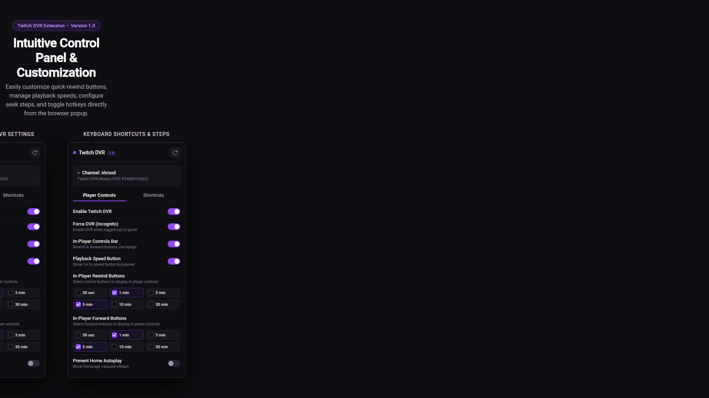

# Twitch DVR

**Rewind live Twitch streams, use dedicated in-player playback speed controls, customizable quick-seek buttons, and force DVR availability without requiring a login.**

[](https://addons.mozilla.org/en-US/firefox/addon/twitch-dvr/)
[](https://github.com/PlasmaDrifter/twitch-DVR)
[](LICENSE)
[](https://twitch.tv)

---

## Overview

**Twitch DVR** is a lightweight, private WebExtension for Firefox and Zen Browser that brings native DVR functionality to live Twitch streams. It seamlessly integrates clean player controls into Twitch's video control bar, allowing you to rewind live broadcasts, watch at custom playback speeds (0.5x–2x), configure quick-seek steps, and return to the live edge instantly.

Unlike standard Twitch playback which restricts live scrubbing to Turbo subscribers on select partner channels, Twitch DVR unlocks client-side DVR controls across all live streams with active VOD archiving without requiring a Twitch Turbo subscription or user account login.

---

## Installation

### Firefox & Zen Browser (Mozilla Add-ons)
Install directly from the official Mozilla Add-ons directory:
[**Install Twitch DVR on AMO**](https://addons.mozilla.org/en-US/firefox/addon/twitch-dvr/)

1. Open the [Twitch DVR Add-on Page](https://addons.mozilla.org/en-US/firefox/addon/twitch-dvr/) in Firefox or Zen Browser.
2. Click **Add to Firefox**.
3. When prompted by Firefox, confirm the installation by clicking **Add**.
4. Open any live stream on Twitch (e.g. `twitch.tv/<channel>`) and enjoy native DVR controls.

---

## Screenshots

### In-Player DVR Controls & Speed Flyout


### Extension Popup Settings & Hotkey Configuration


---

## Key Features

- **Live Stream DVR Rewinding**: Scrub backward and forward through hours of live broadcast history directly on the player timeline.
- **Customizable In-Player Quick-Seek Buttons**: Choose which buttons appear in the player controls (30s, 1m, 3m, 5m, 10m, 30m for both rewind and forward).
- **Proactive VOD Discovery**: Background GraphQL lookup immediately queries the streamer's active broadcast manifest on load, activating the DVR seekbar reliably.
- **Reliable Live-Edge Transition**: Seamlessly transitions from live stream playback into DVR mode without stalling, dropping buffer, or stuttering.
- **Interactive Live / Go Live Badge**: Displays current sync status. When rewound behind live, clicking `GO LIVE` immediately snaps playback back to the live broadcast edge.
- **Playback Speed Selector (0.5x–2.0x)**: Compact speed flyout supporting 0.5x, 0.75x, 1.0x, 1.25x, 1.5x, 1.75x, and 2.0x speeds, with automatic reset to 1.0x upon catching up to the live edge.
- **Dedicated Speed Button Toggle**: Toggle whether the speed button and flyout appear in the player controls bar from the popup.
- **Twitch Settings Menu Integration**: Adds a native `Playback Speed (DVR)` row directly inside Twitch's player settings gear menu.
- **Zero-Login DVR Access**: Unlocks DVR capabilities even when logged out or browsing in incognito mode.
- **Clean Channel Navigation**: Clears and resets stream state automatically when navigating between channels in Twitch's single-page application without leaking past broadcast IDs.
- **Frontpage Carousel Autoplay Blocker**: Optionally stops the Twitch homepage carousel from auto-playing video and sound without affecting sidebar channel previews or hover previews.
- **Muted Native Twitch Styling**: Translucent dark slate surfaces and platinum icons designed to blend naturally with Twitch's dark UI without fluorescent glows or neon pulses.
- **Full Keyboard Shortcut Support**:
  - `J` or `Left Arrow`: Rewind primary step (configurable: 5s, 10s, 15s, 30s).
  - `L` or `Right Arrow`: Fast-forward primary step.
  - `Shift + Left Arrow`: Rewind 30s.
  - `Shift + Right Arrow`: Fast-forward 30s.
  - `Shift + L` or `0`: Jump to live edge.
  - `[` / `]`: Decrease / increase playback speed.

---

## Project Structure

```text
twitch-DVR/
├── README.md
├── LICENSE
├── release/
│   ├── manifest.json
│   ├── background.js
│   ├── build.sh
│   ├── AMO_DESCRIPTION.md
│   ├── AMO_RELEASE_NOTES.md
│   ├── icons/
│   ├── content/
│   │   ├── gql-hook.js
│   │   ├── content-bridge.js
│   │   ├── player-controls.js
│   │   └── player-controls.css
│   └── popup/
│       ├── popup.html
│       └── popup.js
├── store_assets/
│   ├── icon-128.png
│   ├── icon-512.png
│   ├── popup-preview.png
│   ├── popup-showcase.png
│   ├── player-controls-preview.png
│   └── controls-focused.png
└── test/
    ├── manifest.json
    ├── background.js
    ├── build.sh
    ├── icons/
    ├── content/
    └── popup/
```

---

## Building and Packaging

### 1. Build Production Release (AMO Package)
```bash
cd release
./build.sh
```
This generates:
- `release/twitch-dvr-v1.0.zip` (clean archive ready for AMO submission)
- `release/twitch-dvr.xpi` (local testing file)

### 2. Linting for Mozilla Add-on Store (AMO)
```bash
npx web-ext lint --source-dir release --ignore-files "build.sh" "*.zip" "*.xpi" "AMO_*.md"
```

---

## Privacy & Security

- Zero analytics, zero trackers, zero telemetry, and zero remote dependencies.
- No user credentials, tokens, or personal identifiers are stored or transmitted.
- All configuration options are stored strictly inside your browser's sandboxed local extension storage.

---

## License

MIT License. See [LICENSE](LICENSE) for details.
